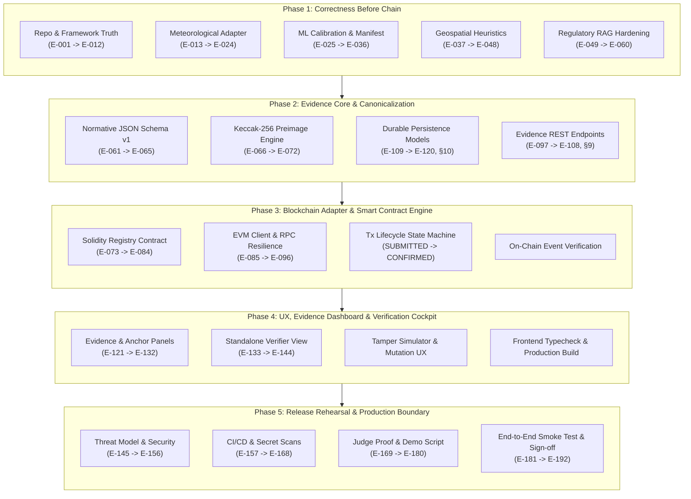

# 🛡️ AEGIS-CLIMATE: PRD-2 Engineering & Blockchain Phase Division
> **Source Document:** [`AEGIS_PRD_2_Engineering_Blockchain.md`](./AEGIS_PRD_2_Engineering_Blockchain.md)  
> **Total Requirements Covered:** 192 Engineering Specifications (`E-001` → `E-192`)  
> **Workflow Pattern per Phase:** `Build` ➔ `Debug` ➔ `Test` ➔ `Verify (All Pass)` ➔ `Git Commit to main`

---

## 🗺️ Architectural Phase Map

---

## 📌 Detailed Phase-by-Phase Breakdown

---

### 🔹 Phase 1: Correctness Before Chain (Foundation & Data Truth)
*“Pehele data aur logic ko truthful banao, chain par garbage commit nahi karna.”*

* **PRD Sections Covered:**
  - §1: Repository baseline and implementation truth (`E-001` → `E-012`)
  - §2: Meteorological source adapter (`E-013` → `E-024`)
  - §3: ML evaluation and model artifact (`E-025` → `E-036`)
  - §4: Geospatial engine remediation (`E-037` → `E-048`)
  - §5: Regulatory RAG hardening (`E-049` → `E-060`)
* **Core Objectives:**
  1. **Framework & Code Inventory Truth:** Ensure docs explicitly identify React 19 + Vite + TypeScript (remove legacy Next.js claims).
  2. **Config & Secret Hygiene:** Centralize all settings in typed Pydantic models; enforce strict CORS allowlist (kill wildcard `*`); prevent server stack traces from leaking to clients.
  3. **Meteorological Source Adapter:** Decouple Open-Meteo into an independent adapter. Calculate 24h and 7d rainfall from independent hourly series (eliminate naive `24h * 2.8` multiplier). Handle soil moisture fractions properly. Add synthetic fallback flags (`is_synthetic=True`).
  4. **Geospatial Heuristics Labeling:** Label topological depth, building counts, and drainage overflow as calibrated heuristics, avoiding false claims of surveyed LiDAR/DEM rasters when running without GIS rasters.
  5. **Regulatory RAG Hardening:** Add legal disclaimer stating RAG outputs are research support; attach primary source citations and retrieval confidence scores.
  6. **Model Manifest & Warm-up:** Eliminate cold-start latency failures by prewarming scikit-learn models; pin model artifact SHA-256.
* **Building Deliverables:**
  - `backend/app/errors.py`: Standardized domain exceptions (`AEGISError`, `ErrorResponse`).
  - `backend/app/middleware.py`: Request correlation ID tracking and security headers.
  - `backend/app/config.py`: Hardened CORS and typed blockchain/DB settings.
  - `backend/app/weather/`: `schemas.py`, `adapter.py`, `cache.py`.
  - Refactored `backend/app/routes/analyze.py` & `mcp_hub/hub.py`.
* **Testing & Verification:**
  - Coordinate range rejection tests (-90 to 90, -180 to 180).
  - Cache key normalization test.
  - Independent 7-day rainfall vs 24h rainfall assertion.
  - Synthetic fallback flag propagation test.
  - Regression of all existing agent & MCP tests (`pytest tests/`).
* **Git Commit Gate:**
  `feat(phase-1): correctness before chain - weather adapter, safe errors, CORS hardening & heuristic labeling`

---

### 🔹 Phase 2: Evidence Core & Cryptographic Integrity
*“Evidence bundle ka normative schema, deterministic canonicalization, aur genuine Keccak-256 digest engine.”*

* **PRD Sections Covered:**
  - §6: Evidence bundle schema: normative definition (`E-061` → `E-072`)
  - §9: API contract proposal (`E-097` → `E-108`)
  - §10: Persistence and migrations (`E-109` → `E-120`)
* **Core Objectives:**
  1. **Normative JSON Schema v1:** Create `schemas/climate-evidence.v1.schema.json` with strict validation (`additionalProperties: false`, ISO-8601 UTC with `Z`, finite numbers, no NaN/Inf).
  2. **Deterministic Canonicalization Engine:** Alphabetically sort object keys recursively, apply Unicode NFC normalization, format floats consistently, and strip mutable transport fields (`digest`, `tx_hash`, `anchor_status`).
  3. **Genuine Ethereum Keccak-256 Digest:** Compute true Ethereum Keccak-256 over canonical UTF-8 bytes (ensuring separation from FIPS SHA3-256).
  4. **Evidence Persistence Store:** Implement durable data models for `analysis_runs`, `evidence_bundles`, and `anchor_transactions`.
  5. **Evidence REST Endpoints:**
     - `POST /api/v1/evidence`: Create and persist versioned bundle from analysis run.
     - `GET /api/v1/evidence/{evidence_id}`: Retrieve bundle and lifecycle status.
     - `POST /api/v1/evidence/verify`: Independent cryptographic verification endpoint.
  6. **Golden Test Fixture & Tamper Detection:** Generate `tests/fixtures/golden_evidence_bundle.json`.
* **Building Deliverables:**
  - `schemas/climate-evidence.v1.schema.json`
  - `backend/app/evidence/schema.py`
  - `backend/app/evidence/canonicalize.py`
  - `backend/app/evidence/digest.py`
  - `backend/app/evidence/service.py`
  - `backend/app/db/models.py`
  - `backend/app/routes/evidence.py`
* **Testing & Verification (P0 Gate):**
  - Schema validation rejects missing required properties or extra fields.
  - Exact digest equality across multiple canonicalization runs.
  - Ethereum Keccak-256 verified to produce different output than FIPS SHA3-256.
  - **Single-field tamper gate:** Original bundle passes ➔ 1 field mutated (e.g. `risk_score` modified) fails with `tamper_detected: true` ➔ restored original passes again.
* **Git Commit Gate:**
  `feat(phase-2): evidence core - normative json schema v1, canonicalizer, keccak256 digest & tamper verification`

---

### 🔹 Phase 3: Blockchain Adapter & Smart Contract Engine
*“Smart contract interface, Web3 client, transaction lifecycle state machine, aur on-chain event verification.”*

* **PRD Sections Covered:**
  - §7: Solidity registry contract (`E-073` → `E-084`)
  - §8: Blockchain network adapter and transaction lifecycle (`E-085` → `E-096`)
* **Core Objectives:**
  1. **Solidity Registry Contract (`ClimateEvidenceRegistry.sol` / `AEGISRiskLedger.sol`):**
     - Emits indexed event `EvidenceAnchored(bytes32 indexed digest, bytes32 indexed reportRef, uint32 schemaVersion, address indexed issuer, uint256 blockTimestamp)`.
     - Validates inputs: non-zero digest, supported schema version, caller access control (`onlyBackend`/`onlyOwner`).
     - Idempotency & duplicate digest defense (prevents duplicate spam or ambiguous duplicate outcomes).
     - Storage privacy: strictly NO raw weather time-series, personal data, or full narratives stored on-chain.
  2. **EVM Adapter & RPC Resilience:**
     - Web3 client connecting to Polygon Amoy Testnet (Chain ID 80002) and local Hardhat/Anvil (Chain ID 31337).
     - Chain ID allowlist enforcement before signing or broadcasting.
     - Nonce management, gas price buffer, and timeout budget.
  3. **Transaction Lifecycle State Machine:**
     - Transitions: `CREATED` ➔ `SUBMITTED` ➔ `PENDING` ➔ `CONFIRMED` / `REVERTED`.
     - Confirmation depth tracking (min 2 confirmations).
     - Transaction receipt decoder matching event signature and digest against stored record.
  4. **Anchoring REST Endpoints:**
     - `POST /api/v1/evidence/{evidence_id}/anchor`: Triggers anchoring on-chain.
     - `GET /api/v1/evidence/{evidence_id}/anchor-status`: Returns mined block, receipt status, and explorer link.
* **Building Deliverables:**
  - `contracts/AEGISRiskLedger.sol` (or `ClimateEvidenceRegistry.sol`)
  - `backend/app/blockchain/chain_client.py` (live Web3 provider with receipt verifier)
  - `backend/app/blockchain/evidence_verifier.py`
  - `backend/app/routes/blockchain.py`
* **Testing & Verification:**
  - Authorized issuer anchors valid digest; event args match receipt.
  - Zero digest or unauthorized caller reverts transaction.
  - Duplicate anchor handles replay safely.
  - Receipt polling backoff handles network lag without hanging API.
  - Local EVM integration test (`tests/test_blockchain_integration.py`).
* **Git Commit Gate:**
  `feat(phase-3): blockchain adapter - smart contract registry, web3 client, tx lifecycle & receipt event parser`

---

### 🔹 Phase 4: UX, Evidence Dashboard & Verification Cockpit
*“Frontend mein visual evidence panel, live transaction lifecycle, explorer links, aur standalone verifier tool.”*

* **PRD Sections Covered:**
  - §11: Frontend dashboard integration (`E-121` → `E-144`)
* **Core Objectives:**
  1. **Evidence Panel Component (`EvidencePanel.tsx`):**
     - Displays current evidence bundle metadata, schema version, canonical hash algorithm, and Keccak-256 digest.
     - One-click copy for digest and raw canonical JSON export.
     - Visual badge showing data mode: `LIVE TELEMETRY`, `CERTIFIED FIXTURE`, or `SYNTHETIC FALLBACK`.
  2. **Anchor Status & Explorer Component (`AnchorStatus.tsx`):**
     - Real-time transaction state pill: `NOT ANCHORED` ➔ `SUBMITTING` ➔ `PENDING` ➔ `CONFIRMED`.
     - Direct PolygonScan explorer link derived from allowlisted network config.
     - Prominent "Local Simulation" tag when connected to local Hardhat/Anvil (PRD 2: `E-095`).
  3. **Standalone Evidence Verifier Page / Modal:**
     - Allows judges or third parties to upload any `.json` evidence file.
     - Runs client-side / backend verification: recomputes Keccak-256 digest, checks on-chain event log, and highlights match/mismatch.
  4. **Interactive Tamper Testing Simulator:**
     - Interactive scenario: Judge clicks "Simulate Data Mutation" (alters 1 parameter) ➔ verifier instantly flags `TAMPER DETECTED: DIGEST MISMATCH`.
  5. **TypeScript Production Build:**
     - Zero TypeScript errors (`tsc -b`), strict lint compliance (`oxlint`), clean Vite production bundle (`dist/`).
* **Building Deliverables:**
  - `frontend/src/components/EvidencePanel.tsx`
  - `frontend/src/components/AnchorStatus.tsx`
  - `frontend/src/components/BlockchainPanel.tsx` (updated with v2 endpoints)
  - `frontend/src/App.tsx` (integrated evidence navigation)
* **Testing & Verification:**
  - Vite build passes (`npm run build`).
  - Frontend dist assets generated (`index.html`, JS bundles, SVGs).
  - Component renders without console errors or unhandled promise rejections.
  - End-to-end frontend test passes (`test_phase5_e2e.py`).
* **Git Commit Gate:**
  `feat(phase-4): ux & evidence dashboard - evidence panel, anchor status, standalone verifier & tamper simulator`

---

### 🔹 Phase 5: Release Rehearsal & Production Boundary
*“Security hardening, threat model, reproducible Docker quickstart, judge demo runbook, aur final sign-off.”*

* **PRD Sections Covered:**
  - §12: Security, privacy, and threat modelling (`E-145` → `E-156`)
  - §13: Automated test strategy (`E-157` → `E-168`)
  - §14: CI, packaging, deployment, and operations (`E-169` → `E-180`)
  - §15: Demo engineering and judge proof (`E-181` → `E-186`)
  - §16: Release acceptance and production boundary (`E-187` → `E-192`)
* **Core Objectives:**
  1. **Threat Model & Security Documentation:**
     - Create `docs/THREAT_MODEL.md` (boundaries: untrusted browser, untrusted weather feeds, server-side secret safety).
     - Create `docs/DATA_PROVENANCE.md` (data sources, update frequencies, limitations).
     - Create `docs/CHAIN_DEPLOYMENT.md` (contract addresses, ABIs, network RPCs, verification guide).
     - Create `docs/PRODUCTION_READINESS.md` (honest statement: hackathon prototype vs enterprise SLA).
  2. **CI / CD Pipeline:**
     - GitHub Actions workflow (`.github/workflows/ci.yml`): Python lint & tests, TypeScript build, secret scans.
  3. **Zero Secrets in Repository:**
     - Verify no private keys, JWTs, or API keys are committed or exposed in frontend bundle (`.env.example` audited).
  4. **End-to-End Golden Cascade Smoke Test:**
     - Single automated script executing the full pipeline:
       `Analyze Location` ➔ `Generate Evidence Bundle` ➔ `Compute Keccak-256` ➔ `Anchor On-Chain` ➔ `Verify Receipt & Event` ➔ `Tamper Mutation Fails`.
  5. **Final Test Suite Pass:** 100% of all Python unit/integration tests and TypeScript builds pass without a single failure.
* **Building Deliverables:**
  - `docs/THREAT_MODEL.md`
  - `docs/DATA_PROVENANCE.md`
  - `docs/CHAIN_DEPLOYMENT.md`
  - `docs/PRODUCTION_READINESS.md`
  - `.github/workflows/ci.yml`
  - `scripts/verify_e2e_evidence.py`
* **Testing & Verification:**
  - Full CI test run passing.
  - Secret scan passing with zero leaked tokens.
  - Judge proof runbook verified from clean checkout.
* **Git Commit Gate:**
  `feat(phase-5): release rehearsal - threat model, documentation, ci pipeline & end-to-end judge verification`

---

### 🔹 Phase 6: Winning Edge — Executive Briefing, Bhasha-AI & Judge Proof
*“C-Suite Executive Briefing JSON/HTML printable reports, Bhasha-AI Devanagari voice dispatch, Pitch Deck, aur Demo Runbook.”*

* **PRD Sections & Competition Edge Covered:**
  - §11, §15, §16: Executive deliverables & presentation artifacts
* **Core Objectives:**
  1. **Executive Briefing Engine:**
     - `GET /api/v1/events/{event_id}/executive-briefing`: Full structured C-Suite risk assessment.
     - `GET /api/v1/events/{event_id}/executive-briefing/html`: Printable A4 PDF/HTML report ready for boardroom decision-makers with `window.print()`.
  2. **Bhasha-AI Vernacular Voice Dispatch:**
     - High-urgency Devanagari Hindi (`[\u0900-\u097F]`) and English warnings for ground emergency teams.
  3. **What-If Extreme Stress Comparison:**
     - Verified differentiation between nominal semi-arid dry conditions and catastrophic cloudburst scenarios.
  4. **Official Presentation & Video Runbook:**
     - Updated `docs/PITCH_DECK.md` (9 widescreen slides with cryptographic proof & Web3 anchoring).
     - Updated `docs/DEMO_SCRIPT.md` (2:30 min video runbook including live tamper simulation).
* **Testing & Verification:**
  - All 5 winning edge verification tests pass (`tests/test_phase6_winning_edge.py`).
* **Git Commit Gate:**
  `feat(phase-6): winning edge - executive briefing, bhasha-ai bilingual verification & judge pitch deck`

---

## 📊 Summary Matrix

| Phase | Focus Area | PRD Sections | Requirements | Acceptance Criteria to Commit |
| :---: | :--- | :---: | :---: | :--- |
| **Phase 1** | **Correctness Before Chain** | §1 – §5 | `E-001` → `E-060` | Weather adapter independent 7d rain, safe errors, CORS fixed, model prewarmed, 100% baseline tests pass. |
| **Phase 2** | **Evidence Core** | §6, §9, §10 | `E-061` → `E-072`, `E-097` → `E-120` | JSON schema v1, canonicalization engine, Keccak-256 digest, single-field tamper detection test passes. |
| **Phase 3** | **Blockchain Adapter** | §7 – §8 | `E-073` → `E-096` | Contract event decoding matches receipt, Web3 client connected, idempotent retry, local EVM test passes. |
| **Phase 4** | **UX & Evidence Cockpit** | §11 | `E-121` → `E-144` | EvidencePanel & AnchorStatus UI, standalone verifier, tamper simulator, `npm run build` zero-error pass. |
| **Phase 5** | **Release Rehearsal** | §12 – §16 | `E-145` → `E-192` | Threat model & docs written, CI config ready, full E2E smoke test passes, final sign-off. |
| **Phase 6** | **Winning Edge & Briefing** | §11, §15, §16 | Edge & Demo | C-Suite A4 printable briefing, Bhasha-AI Devanagari alerts, Pitch Deck, 100% winning edge tests pass. |
