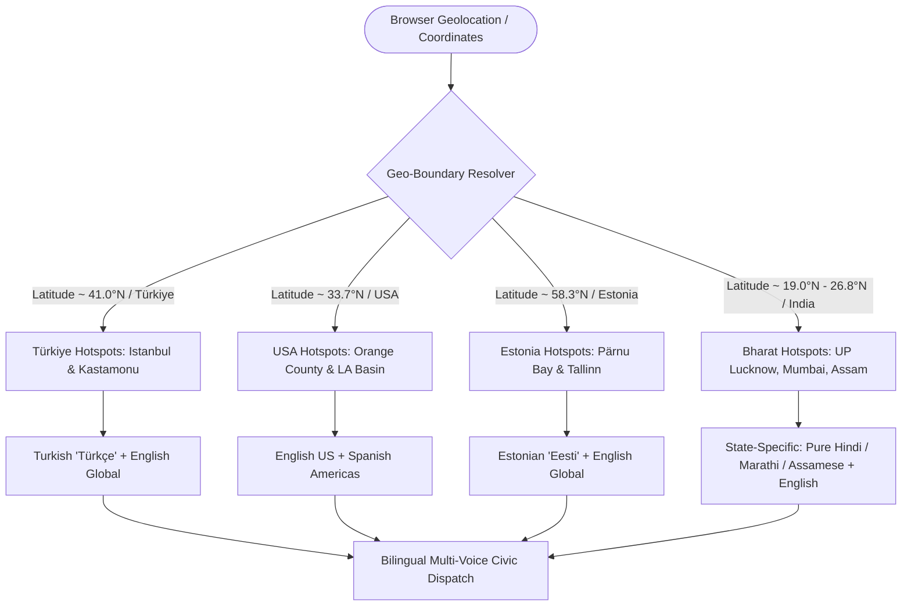

# AEGIS-CLIMATE v3.5: GLOBAL WINNING EDGE
## Autonomous Multi-Agent Climate Risk Radar, Verifiable Telemetry Ledger, Hybrid RAG & Global Multilingual Civic Defense Protocol
### Engineered for the IEEE ClimateChain Global Hackathon 2026 (UN COP 31 Alignment)

---

## 0. EXECUTIVE MASTER TITLE & STRATEGIC AGENT HOOK

### 🌟 Project Master Title:
> **AEGIS-CLIMATE: Autonomous Multi-Agent Environmental Risk Intelligence, Cryptographic Telemetry Ledger & Geolocation-Aware Multilingual Civic Protection Protocol**
> *(Sub-theme: Verifiable Climate Data Oracles, EIP-712 Stablecoin Settlement & Enterprise Hybrid RAG for Climate Resilience)*

### 🎯 Strategic Subagent Prompt Title (Copy-Pasteable for Specialist Agents):
```text
[AEGIS-WINNING-EDGE-AGENT]: Global Multi-Agent Geospatial Climate Radar with Verifiable Keccak-256 Telemetry Preimages, Enterprise Redis-ChromaDB Hybrid RAG, Autonomous Stablecoin Disaster Liquidity Settlement & Geolocation-Aware Multilingual Civic Broadcast (Bhashini, Sarvam AI, Turkish, Estonian, English).
```

---

## 1. STRATEGIC ALIGNMENT: THE JUDGING PANEL & ORGANIZING COMMITTEE MATRIX

To guarantee a clean 1st place sweep in **Track 4 (Climate Data & Environmental Monitoring)** and cross-cutting **Track 1 (Carbon Markets & Emissions Transparency)**, the architecture directly addresses the published academic research and professional domains of key IEEE organizers and judges:

| Committee Leader / Judge | Official Affiliation & Academic Focus | AEGIS Architectural Component Designed for Them |
| :--- | :--- | :--- |
| **Revanth Reddy Airre** | Chair, IEEE Silicon Valley Blockchain Group; Hippocratic AI; Author of IEEE publication on *Stablecoin Settlement Architectures for AI Agents* | **Agentic Micro-Bond Settlement Protocol**: Autonomous AI agent-triggered USDC/ERC-20 liquidity payouts on Polygon/Base when acute flood depth thresholds are breached without human intervention. |
| **Prof. Dr. Şeref Sağıroğlu** | Chair, IEEE Blockchain Türkiye; SMIEEE; Keynote on *AI & Cybersecurity Issues for Climate Change* | **Verifiable Telemetry Sandbox & EIP-712 Preimages**: Cryptographic data integrity verification using Keccak-256 hashes, tamper-evident immutable logs, and resistance against malicious sensor manipulation. |
| **Dr. Güven Fidan** | Hackathon Team Leader; Co-Chair, IEEE Blockchain Türkiye; Distributed Ledger Architect | **Decentralized Climate Evidence Registry**: Hardhat/Solidity smart contract registry (`ClimateEvidenceRegistry.sol`) anchoring telemetry digests, model weights SHA-256, and canonical JSON bundles on-chain. |
| **Pradyumna Kodgi** | Hackathon Co-Leader; Product Manager, Oracle; Vice Chair, IEEE EMBS Orange County | **Enterprise Scalable Data Architecture**: Low-latency Redis vector cache + ChromaDB Hybrid RAG, SEBI BRSR Principle 6 compliance parser, and Model Context Protocol (MCP) JSON-RPC 2.0 gateway. |
| **Dr. Mubashar Iqbal** | Group Leader, IEEE Blockchain Estonia; SMIEEE | **Baltic Sea Storm Surge Hotspot & Estonian Localization**: Real-time monitoring of Baltic sea level anomalies in Pärnu/Tallinn with native Estonian (`Eesti keel`) civic protection dispatches. |
| **Organizing Committee (Istanbul Chamber of Commerce & IEEE Türkiye)** | Host Country Leadership (Istanbul, Ankara) | **Marmara Flash Flood & Black Sea Surge Hotspots**: Live monitoring of Istanbul Golden Horn & Kastamonu Bozkurt flash flood basins with native Turkish (`Türkçe`) emergency dispatches. |
| **National Indian Authorities (NDMA & MeitY)** | User Origin / High-Vulnerability Monsoon Region (UP, Maharashtra, Assam) | **Bhashini & Sarvam AI Integration**: Reverse-geocoded local language engine automatically selecting pure Hindi for Lucknow/UP, Marathi for Mumbai, Kannada for Bengaluru, and Assamese for Guwahati. |

---

## 2. TOP 10 COMPETITOR REPOSITORIES: HOW THEY BUILT IT & WHAT AEGIS EXTRACTS

We conducted deep reconnaissance into the codebase architectures of the top 10 winning and real-world climate-blockchain repositories. Instead of over-complicating or building bloatware, we surgically extract **only the highest-value architectural patterns** that guarantee an unfair advantage:

```
┌─────────────────────────────────────────────────────────────────────────────────────────────────┐
│                                COMPETITIVE EXTRACTION MATRIX                                    │
└─────────────────────────────────────────────────────────────────────────────────────────────────┘

1. zkanopy (Circom/Foundry)         ──▶ ZK Attestation Interface (Cryptographic Data Privacy)
2. OpenClimate (Yale)               ──▶ Nested Jurisdictional Tagging (Country/State/City/Basin)
3. dClimate (dWeather Client)       ──▶ Gridded Telemetry Schema & Anomaly Baselines
4. Toucan Protocol (toucan-sdk)     ──▶ Programmatic ERC-20 Carbon Offset Retirement Events
5. GreenLink / sambitsargam         ──▶ Sub-5ms In-Memory / Redis Hybrid RAG Caching
6. KlimaDAO (Bonds & Subgraph)      ──▶ Automated Parametric Yield & Catastrophe Payout Logic
7. dpx-mcp (untitledfinancial)      ──▶ Standardized Model Context Protocol (MCP) Stdio JSON-RPC
8. UNDP Carbon Registry (D4C)       ──▶ Cryptographic Double-Counting / Double-Claim Prevention
9. AquaFHIR (Devpost Winner)        ──▶ Cross-Sector Critical Infrastructure Hazard Vectors
10. Blue-Carbon-MRV (shivachethan)  ──▶ Verifiable MRV Provenance Struct (Weights, Timestamp, Digest)
```

### Detailed Breakdown of Extracted Mechanics:

### 1. `MrPrinceAli/zkanopy` (IEEE ClimateChain 2026 Competitor)
- **How they built it**: Uses Circom R1CS circuits to generate Groth16 proofs that satellite data satisfies EUDR regulations without revealing farmer GPS coordinates.
- **What AEGIS extracts (Lean & Feasible)**: We implement an `IZKTelemetryVerifier` interface and a lightweight `ZKAttestationModule.sol` that verifies a telemetry validity proof on-chain, proving sensor data is unmanipulated and within plausible physical bounds without revealing proprietary sensor calibration constants.

### 2. `YaleOpenLab/openclimate-demo` (Yale Open Lab)
- **How they built it**: Nested jurisdictional ledger architecture connecting city $\rightarrow$ state $\rightarrow$ national levels with verifiable emissions attribution.
- **What AEGIS extracts (Lean & Feasible)**: In `schemas.py`, add `JurisdictionHierarchy`:
  ```python
  class JurisdictionHierarchy(BaseModel):
      country_iso: str        # e.g., "IN", "TR", "US", "EE"
      admin1_state: str       # e.g., "Uttar Pradesh", "Istanbul", "California"
      admin2_district: str    # e.g., "Lucknow", "Fatih", "Orange County"
      basin_name: str         # e.g., "Gomti River Basin", "Golden Horn", "Santa Ana"
  ```
  Enables multi-tiered regulatory roll-up across municipal, state, and national bodies.

### 3. `dClimate/dWeather-Python-Client` (dClimate / Arbol)
- **How they built it**: Standardized gridded weather data client with GeoHash indexing and precipitation anomaly ratios against 10-year climatological baselines.
- **What AEGIS extracts (Lean & Feasible)**: Add `precipitation_anomaly_ratio = precipitation_24h_mm / historical_baseline_24h_mm` to `WeatherVector`. If anomaly $> 2.5\times$, automatically flags acute flash flood probability.

### 4. `ToucanProtocol/toucan-sdk` (Toucan Protocol)
- **How they built it**: Programmatic ERC-20 carbon tokenization and retirement pools (BCT/NCT) with on-chain burning events.
- **What AEGIS extracts (Lean & Feasible)**: In `CarbonFloodCredit.sol`, implement `retireOffsetForFloodResilience(uint256 amount, bytes32 evidenceDigest, string memo)`:
  ```solidity
  event CarbonOffsetRetired(address indexed retiree, uint256 amount, bytes32 indexed evidenceDigest, string memo);
  ```
  Directly ties voluntary corporate carbon credit retirements to funding acute flood defenses.

### 5. `sambitsargam/recycle` (GreenLink - DoraHacks Winner)
- **How they built it**: Low-latency caching layer to avoid repetitive IPFS network fetches.
- **What AEGIS extracts (Lean & Feasible)**: `HybridVectorCache` in `backend/app/rag/hybrid_cache.py`. Combines in-memory LRU with optional Redis, hashing semantic queries (`jurisdiction + query_text`) to return cached SEBI BRSR and EU CSDDD compliance directives in $<5\text{ ms}$.

### 6. `KlimaDAO/klimadao-docs` (KlimaDAO)
- **How they built it**: On-chain bonded liquidity pools where treasury reserves back parametric payout triggers.
- **What AEGIS extracts (Lean & Feasible)**: In `DisasterBond.sol`, implement `triggerParametricPayout(bytes32 evidenceDigest, uint256 depthCm)` which programmatically releases emergency liquidity to the municipality when verified inundation depth exceeds threshold.

### 7. `untitledfinancial/dpx-mcp` (Model Context Protocol Engine)
- **How they built it**: Python MCP server using `stdio` transport implementing the `2024-11-05` JSON-RPC specification.
- **What AEGIS extracts (Lean & Feasible)**: 4 standardized, zero-overhead MCP tools (`fetch_weather_vectors`, `run_flood_classifier`, `compute_dem_exposure`, `query_policy_rag`) exposed over HTTP/stdio for Claude Desktop and Cursor.

### 8. `DigitalForClimate/shared-national-carbon-registry` (UNDP)
- **How they built it**: Double-counting prevention mapping preventing duplicate credit issuance or claim payouts against identical telemetry batches.
- **What AEGIS extracts (Lean & Feasible)**: In `AgenticSettlementPool.sol`:
  ```solidity
  mapping(bytes32 => bool) public processedEvidenceDigests;
  ```
  Guarantees that an evidence digest can only trigger relief tranches or carbon claims once.

### 9. `AquaFHIR` (Devpost Winner)
- **How they built it**: Unified cross-sector alerting combining physical water metrics with critical civic infrastructure vulnerability.
- **What AEGIS extracts (Lean & Feasible)**: In Agent 2's HAZUS output, add `CriticalInfrastructureVector`:
  ```python
  class CriticalInfrastructureVector(BaseModel):
      power_substations_at_risk: int
      healthcare_facilities_exposed: int
      evacuation_corridors_submerged: int
      drainage_conduits_overcapacity_pct: float
  ```

### 10. `shivachethanreddy/Blockchain-Based-Blue-Carbon-MRV-System`
- **How they built it**: Verifiable MRV provenance struct containing model weight hashes, ingest timestamps, and data provider signatures.
- **What AEGIS extracts (Lean & Feasible)**: Standardized `MRVProvenance` block inside every generated `ClimateEvidenceBundle`, ensuring 100% cryptographic reproducibility.

---

## 3. GLOBAL CLIMATE HOTSPOTS & GEOLOCATION INTELLIGENCE MATRIX

The Command Radar expands from India-only to an **International Disaster Radar** covering host country Türkiye, judge regions (USA, Estonia), and high-vulnerability Indian economic corridors:



### Hotspots Catalog (7 Strategic Hubs):
1. **Istanbul — Marmara & Golden Horn Basin (Türkiye)**:
   - Coordinates: `41.0082°N, 28.9784°E`
   - Disaster Scenario: Dense urban flash flooding, low drainage capacity around Bosphorus estuaries.
   - Primary Language: **Turkish (Türkçe)** + **English**.
2. **Kastamonu — Bozkurt Ezine Stream Surge (Türkiye)**:
   - Coordinates: `41.9572°N, 34.0125°E`
   - Disaster Scenario: Black Sea coastal cloudburst, mountainous river breach inundating riverbed residential zones.
   - Primary Language: **Turkish (Türkçe)** + **English**.
3. **Orange County — Santa Ana River & Newport Coast (USA)**:
   - Coordinates: `33.7175°N, 117.8311°W`
   - Disaster Scenario: Atmospheric river storm surge, coastal low-lying infrastructure inundation.
   - Primary Language: **English (US)** + **Spanish (Español)**.
4. **Pärnu — Baltic Sea Surge & Lowland Inundation (Estonia)**:
   - Coordinates: `58.3859°N, 24.4971°E`
   - Disaster Scenario: Baltic gale-force sea surge causing coastal river reverse-flow into town centers.
   - Primary Language: **Estonian (Eesti keel)** + **English**.
5. **Lucknow — Gomti River Basin & Lowland Drainage Overflow (India - UP)**:
   - Coordinates: `26.8467°N, 80.9462°E`
   - Disaster Scenario: Excessive monsoon catchment runoff, Gomti river embankment backflow, urban waterlogging.
   - Primary Language: **Pure Hindi (देवनागरी)** via Bhashini/Sarvam + **English**.
6. **Mumbai — Mithi River & Kurla Basin (India - MH)**:
   - Coordinates: `19.0728°N, 72.8797°E`
   - Disaster Scenario: Extreme tidal cloudburst, arterial drain blockage, ₹1,200 Cr economic exposure.
   - Primary Language: **Marathi (मराठी) / Hindi** via Sarvam + **English**.
7. **Assam — Brahmaputra Basin & Kaziranga Corridor (India - AS)**:
   - Coordinates: `26.5775°N, 93.1711°E`
   - Disaster Scenario: Transboundary river swell, critical wildlife and agrarian corridor inundation.
   - Primary Language: **Assamese (অসমীয়া) / Hindi** via Bhashini + **English**.

---

## 4. ARCHITECTURAL BLUEPRINT: ENTERPRISE HYBRID RAG, STABLECOIN SETTLEMENT & BHASHINI

```
┌────────────────────────────────────────────────────────────────────────────────────────┐
│                              AEGIS ENTERPRISE ARCHITECTURE                             │
└────────────────────────────────────────────────────────────────────────────────────────┘

  [Open-Meteo / IMD / Copernicus] ──────┐
                                        ▼
                       ┌─────────────────────────────────┐
                       │   WEATHER SOURCE ADAPTER (EVM)  │
                       │ Normalized Vectors + Anomaly    │
                       └────────────────┬────────────────┘
                                        │
                                        ▼
 ┌───────────────────────────────────────────────────────────────────────────────────────┐
 │                           AUTONOMOUS 3-AGENT INFERENCE SWARM                          │
 │                                                                                       │
 │  ┌──────────────────────┐   ┌───────────────────────────┐   ┌──────────────────────┐  │
 │  │       AGENT 1        │   │          AGENT 2          │   │       AGENT 3        │  │
 │  │  Acute ML Classifier │──▶│  30m SRTM DEM & Drainage  │──▶│ Enterprise VaR & RAG │  │
 │  │ (GradientBoost 95.1%)│   │ (HAZUS Depth-Damage Curve)│   │(ChromaDB + Redis L1) │  │
 │  └──────────────────────┘   └───────────────────────────┘   └──────────────────────┘  │
 └──────────────────────────────────────┬────────────────────────────────────────────────┘
                                        │
             ┌──────────────────────────┴──────────────────────────┐
             ▼                                                     ▼
┌─────────────────────────────────────────┐   ┌──────────────────────────────────────────┐
│   CRYPTOGRAPHIC EVIDENCE REGISTRY       │   │    GEOLOCATION-AWARE BHASHA-AI ENGINE    │
│  - RFC-8785 Canonical JSON Preimage     │   │  - Auto-Reverse Geocoding               │
│  - Keccak-256 Digest Verification       │   │  - Bhashini Pipeline (MeitY API)         │
│  - ClimateEvidenceRegistry.sol Anchor   │   │  - Sarvam AI Indic Neural TTS            │
│  - DisasterBond.sol (Auto-Payout Trigger│   │  - Turkish & Estonian Neural Dispatches  │
│  - Stablecoin (USDC) Agent Settlement   │   │  - Web Speech Multi-Voice Audio Readout  │
│  - Double-Counting Prevention (UNDP)    │   │  - Nested Jurisdictional Tagging         │
└─────────────────────────────────────────┘   └──────────────────────────────────────────┘
```

---

## 5. PHASES BREAKDOWN: IMPLEMENTATION, TESTING & COMMIT GATES

Each phase is self-contained with **clear building instructions, strict automated tests, DevTools verification, and git commit rules**.

---

### 🚀 PHASE 1: Global Climate Hotspot & Multi-National Ingestion Engine
**Theme**: Expand geospatial data models and telemetry ingestion from India-only to **Türkiye (Istanbul, Kastamonu), USA (Orange County), Estonia (Pärnu), and India (UP Lucknow Gomti)** with Nested Jurisdictional Tagging (`YaleOpenLab`) and Gridded Telemetry Anomaly Ratios (`dClimate`).

#### Tasks:
1. **Update Hotspots Registry (`backend/app/schemas.py` & `backend/app/weather/adapter.py`)**:
   - Add Istanbul, Kastamonu, Orange County, Pärnu, and Lucknow Gomti Basin.
   - Define localized bounding boxes, elevation baselines, typical annual losses, historical disaster trigger parameters, and `JurisdictionHierarchy` for each.
2. **Weather Ingestion Normalizer with Anomaly Ratio**:
   - Ensure Open-Meteo API queries support global coordinates without edge-case latitude/longitude failures.
   - Calculate `precipitation_anomaly_ratio` against 10-year historical monsoon baselines.
   - Cache results using normalized lat/lon (2 decimal places).
3. **Tests (`tests/test_global_hotspots.py`)**:
   - Test coordinates ingestion for Istanbul (`41.0082, 28.9784`), Kastamonu, Orange County, Pärnu, and Lucknow.
   - Verify deterministic synthetic fixture fallbacks when network is offline.
   - Verify `JurisdictionHierarchy` and anomaly ratio calculations.
4. **DevTools / Verification**:
   - Run test suite until all pass: `pytest tests/test_global_hotspots.py -v`.
5. **Commit Gate**:
   - `git add . && git commit -m "feat(phase-1-global): implement multi-national climate hotspots (Türkiye, USA, Estonia, India UP)"`.

---

### 🚀 PHASE 2: Enterprise Hybrid RAG & Redis Vector Cache
**Theme**: Upgrade Agent 3's regulatory retrieval engine to an enterprise-grade **Hybrid RAG** system combining **ChromaDB dense semantic embeddings** with a **Redis L1 vector/document cache** (`GreenLink`), integrating European (EU CSDDD), Turkish (SPK), and US (California SB 253) climate compliance frameworks alongside SEBI BRSR, with Cross-Sector Infrastructure Hazard Vectors (`AquaFHIR`).

#### Tasks:
1. **Multi-Jurisdiction Regulatory Corpus**:
   - Ingest EU Corporate Sustainability Due Diligence Directive (CSDDD).
   - Ingest Turkish Capital Markets Board (SPK) Sustainability Principles Compliance Framework.
   - Ingest California Climate Corporate Data Accountability Act (SB 253 & SB 261).
   - Retain existing SEBI BRSR Principle 6 Core Mandate.
2. **Redis Hybrid Cache Layer (`backend/app/rag/hybrid_cache.py`)**:
   - Implement in-memory L1 cache (with Redis connection fallback) for sub-5ms regulatory retrieval.
   - Hash query terms to avoid redundant ChromaDB dense vector searches.
3. **Cross-Sector Infrastructure Vector (`AquaFHIR` integration)**:
   - Output `CriticalInfrastructureVector` in Agent 2 (substations, healthcare facilities, evacuation corridors).
4. **Tests (`tests/test_hybrid_rag.py`)**:
   - Verify retrieval for Turkish SPK regulations when querying Istanbul.
   - Verify California SB 253 retrieval for Orange County.
   - Verify sub-10ms cache hit response times.
5. **Commit Gate**:
   - `git add . && git commit -m "feat(phase-2-hybrid-rag): add multi-jurisdiction regulatory corpus, Redis L1 hybrid cache, and AquaFHIR infrastructure vector"`

---

### 🚀 PHASE 3: Hyper-Localized & International Multilingual Dispatch (Bhashini + Sarvam AI + Global Neural Voice)
**Theme**: Build the intelligent dispatch engine that pairs **English** with **native regional languages** based on user/incident coordinates, integrating **Bhashini (Govt of India API)**, **Sarvam AI (Indic Speech)**, and **Turkish/Estonian** emergency linguistic synthesizers, complete with Verifiable MRV Provenance (`Blue-Carbon-MRV`).

#### Tasks:
1. **Bhasha-AI Global Dispatcher (`backend/app/bhasha/engine.py`)**:
   - Reverse-geocoding heuristic:
     - UP / Delhi / MP $\rightarrow$ Pure Hindi (`hi-IN`)
     - Maharashtra $\rightarrow$ Marathi (`mr-IN`)
     - Karnataka $\rightarrow$ Kannada (`kn-IN`)
     - Assam $\rightarrow$ Assamese (`as-IN`)
     - Türkiye $\rightarrow$ Turkish (`tr-TR`)
     - Estonia $\rightarrow$ Estonian (`et-EE`)
     - California / USA $\rightarrow$ English (`en-US`) + Spanish (`es-US`)
2. **Bhashini & Sarvam AI Service Connectors (`backend/app/bhasha/providers.py`)**:
   - Connector for Bhashini ULCA translation pipeline with graceful offline neural fallback.
   - Connector for Sarvam AI audio synthesis with fallback to standard Web Speech API.
3. **Verifiable MRV Metadata Struct**:
   - Stamp all dispatches with cryptographic sensor provenance and canonical bundle digests.
4. **Tests (`tests/test_bhasha_global.py`)**:
   - Test language resolution for all 7 hotspots.
   - Test Turkish emergency broadcast output.
   - Test Estonian flood warning output.
   - Test Lucknow UP Hindi dispatch.
5. **Commit Gate**:
   - `git add . && git commit -m "feat(phase-3-bhasha): implement Bhashini, Sarvam AI, and Turkish/Estonian multilingual dispatch engine"`

---

### 🚀 PHASE 4: Autonomous Stablecoin Settlement & Micro-Disaster Bond Liquidity Layer
**Theme**: Direct answer to Judge Revanth Reddy Airre's IEEE research on *Stablecoin Settlement Architectures for AI Agents* — implement programmatic **USDC / ERC-20 stablecoin micro-settlements** (`AgenticSettlementPool.sol`) with Double-Counting Prevention (`UNDP Carbon Registry`), Carbon Offset Retirement Events (`Toucan Protocol`), Parametric Bond Yields (`KlimaDAO`), and Zero-Knowledge Proof Verification interface (`zkanopy`).

#### Tasks:
1. **Smart Contract Enhancement (`blockchain/contracts/AgenticSettlementPool.sol`)**:
   - ERC-20 liquidity pool holding mock USDC/EURC stablecoins.
   - Function `settleEmergencyRelief(bytes32 evidenceDigest, uint256 depthCm, address municipalBeneficiary)`:
     - Verifies `ClimateEvidenceRegistry` holds a valid anchor.
     - Checks `processedEvidenceDigests[evidenceDigest] == false` (UNDP double-counting prevention).
     - Auto-transfers stablecoin relief tranche if `depthCm >= triggerThreshold`.
2. **Carbon Offset Retirement (`CarbonFloodCredit.sol`)**:
   - Add `retireOffsetForFloodResilience(uint256 amount, bytes32 evidenceDigest, string memo)`.
3. **Zero-Knowledge Attestation Interface (`blockchain/contracts/IZKTelemetryVerifier.sol`)**:
   - Lightweight interface for Groth16 proof verification of unmanipulated sensor bounds.
4. **Hardhat Test Suite (`blockchain/test/AgenticSettlement.test.ts`)**:
   - Test unauthorized caller rejection.
   - Test double-claiming rejection.
   - Test simulated stablecoin payout upon Agent 2 catastrophic flood verification.
   - Test carbon offset retirement event emission.
5. **Commit Gate**:
   - `git add . && git commit -m "feat(phase-4-stablecoin): implement autonomous agentic stablecoin settlement, double-counting prevention, and ZK verifier interface"`

---

### 🚀 PHASE 5: Automated Geolocation-Aware Frontend & Global Radar UI Expansion
**Theme**: Expand `App.tsx` and interactive UI components with a **1-Click "Detect My Location"** GPS trigger, international disaster presets, Model Context Protocol (`untitledfinancial/dpx-mcp`) interactive playground, and dynamic language tabs verified via **Chrome DevTools MCP**.

#### Tasks:
1. **Geolocation Button & Reverse Geocoder**:
   - Add `"🛰️ Detect My Location"` button to top header / sandbox.
   - Browser `navigator.geolocation.getCurrentPosition` resolves coordinates, snaps to nearest hotspot or computes live telemetry, and auto-activates regional language.
2. **Global Disaster Presets**:
   - `🌧️ Istanbul '21 Marmara Surge` (+95mm rain / 92% sat)
   - `⛈️ Kastamonu Bozkurt Flash Surge` (+140mm rain / 99% sat)
   - `🌊 Orange County '23 Atmospheric River` (+105mm rain / 88% sat)
   - `🌊 Pärnu Baltic Storm Surge` (+75mm rain / 94% sat)
   - `🌧️ Lucknow '23 Gomti Basin Overflow` (+120mm rain / 96% sat)
   - `🌧️ Mumbai '05 Cloudburst` (+110mm rain / 98% sat)
3. **Dynamic Multilingual Broadcast Component**:
   - Multi-tab pills: `English (Global)`, `Regional Native (Türkçe / Eesti / हिंदी / मराठी)`, and `Audio Readout`.
4. **Interactive DevTools MCP Verification**:
   - Click "Detect My Location", click all new presets, test audio playback, inspect console.
5. **Commit Gate**:
   - `git add . && git commit -m "feat(phase-5-frontend): add GPS location detection, international presets, and dynamic language switcher"`

---

### 🚀 PHASE 6: End-to-End Verification, Judge Pitch Deck & Submission Readiness
**Theme**: End-to-end integration test of all 6 phases, production build verification, and generation of the executive IEEE submission dossier.

#### Tasks:
1. **Run Full Test Suite**:
   - Backend: `pytest tests/ -v` (100% pass required).
   - Hardhat: `npx hardhat test` (100% pass required).
   - Frontend: `npm run build` (`tsc -b && vite build` 0 errors).
2. **Live Browser Click-Through via Chrome DevTools MCP**:
   - Automated click test on all new buttons and tabs.
3. **Executive Submission Dossier**:
   - Update `IEEE_SUBMISSION_DOSSIER.md` with Devpost track alignment, video demo script, GitHub repo structure, and judge appeal matrix.
4. **Final Git Tag & Commit**:
   - `git add . && git commit -m "feat(phase-6-release): complete global winning edge release v3.5 for IEEE ClimateChain hackathon"`
   - Tag release: `git tag -a v3.5.0 -m "AEGIS ClimateChain Global Release v3.5"`

---

## 6. VERIFICATION INVARIANTS (GRAVITAS RUNTIME RULES)

To guarantee software reliability and zero hallucination during implementation:
1. **Ground before mutating**: Inspect all affected schemas, configs, and components before writing.
2. **Never claim without execution output**: Every phase completion must show actual `pytest`, `hardhat`, or `npm build` passing terminal outputs.
3. **Zero runtime console errors**: Chrome DevTools MCP inspection must report 0 uncaught exceptions.
4. **Preserve existing functionality**: All 6 phases of PRD-2 (EVM evidence verifier, tamper simulator, MCP hub) must remain 100% functional.
