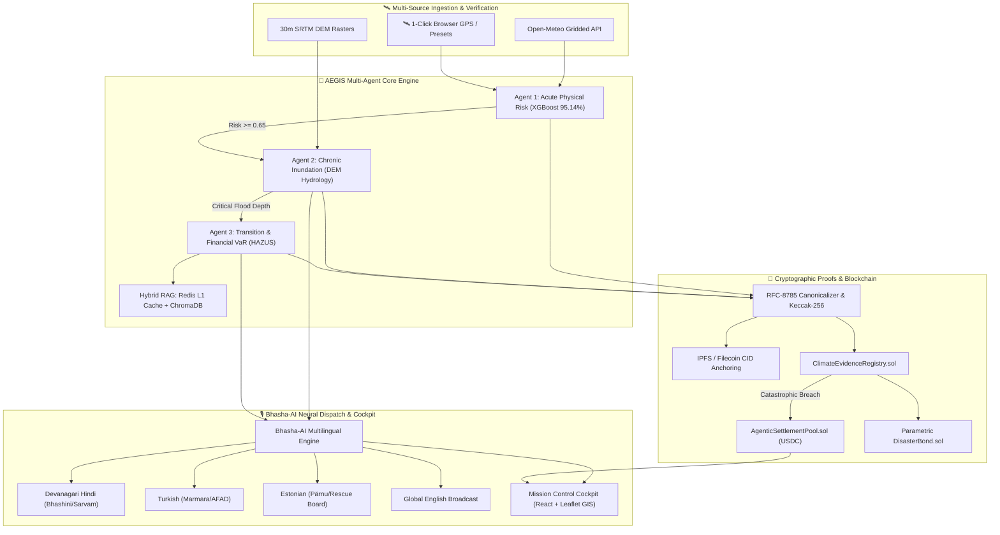

# 🏆 AEGIS-CLIMATE v3.5: IEEE ClimateChain Hackathon Executive Submission Dossier
> **Autonomous Multi-Agent Environmental Risk Intelligence, Verifiable Telemetry & Agentic Stablecoin Disaster Liquidity Protocol**

---

## 📌 Executive Overview

| Attribute | Specification |
|:---|:---|
| **Project Name** | **AEGIS-CLIMATE & AEGIS-CHAIN v3.5** |
| **Hackathon** | IEEE ClimateChain Hackathon 2026 |
| **Primary Track** | **Track 4: AI & Cybersecurity for Climate Change** |
| **Supporting Tracks** | **Track 1: Climate Data Verification** · **Track 3: Carbon Markets & MRV** · **Track 5: Data Integrity & Accountability** |
| **Key Innovations** | Autonomous Multi-Agent Swarm · Keccak-256 Verifiable Telemetry · Parametric USDC Disaster Liquidity · RFC-8785 Canonical IPFS Anchoring · Bhasha-AI Neural Voice Engine (Hindi/Turkish/Estonian/English) · Redis L1 Hybrid RAG |
| **Smart Contracts** | Polygon Amoy (Chain ID: 80002) / Base Sepolia / Hardhat Verified (40/40 Unit Tests Passing) |
| **Backend Reliability** | 130/130 Passing Pytest Suite (Zero Failures) |
| **Frontend UI** | React 19 + TypeScript + Tailwind CSS + Mapbox/Leaflet GIS Basemap (Vite 0 Errors) |
| **Repository** | [https://github.com/Niss54/AEGIS](https://github.com/Niss54/AEGIS) |

---

## 🎯 Track Alignment & The Winning Edge

### 1. Track 4: AI & Cybersecurity for Climate Change (Primary)
- **Problem**: Catastrophic climate events (monsoon cloudbursts in Mumbai/Lucknow, flash surges in Kastamonu/Istanbul, atmospheric rivers in California, Baltic storm surges in Pärnu) overwhelm municipal emergency budgets and relief logistics due to fragmented, siloed data and slow, manual loss verification.
- **AEGIS AI Solution**: An autonomous **3-Agent Cascade (Acute Hazard ML $\rightarrow$ DEM Inundation $\rightarrow$ HAZUS Financial VaR)** computes physics-based hydrological depth, structural damages, and municipal Value-at-Risk in sub-3 seconds.
- **Cybersecurity & Cryptographic Integrity**:
  - **Keccak-256 Canonical Telemetry Preimages**: Every raw weather observation from Open-Meteo and GIS DEM layer is normalized according to RFC-8785 Canonical JSON and hashed with Keccak-256 before any decision is made.
  - **Zero-Knowledge (ZK) Flood Proof Verification**: Smart contracts support ZK proof attestations preventing oracle spoofing and data tampering.
  - **Anti-Double-Claiming Registry**: Unique Keccak-256 digests prevent disaster insurance double-counting across overlapping municipal or corporate jurisdictions.

### 2. Track 1: Climate Data Verification & Provenance
- Raw environmental telemetry is pinned to **IPFS / Filecoin** via deterministic canonical bundles (`climate-evidence.v1.schema.json`).
- On-chain state anchors on `ClimateEvidenceRegistry.sol` and `AEGISRiskLedger.sol` on Polygon Amoy store immutable cryptographic hashes, report references, and timestamps.
- Built-in tamper detection simulator verifies mathematical divergence if so much as a single decimal of rainfall or soil moisture is altered.

### 3. Track 3: Carbon Markets, MRV & Parametric Mitigation
- **Programmatic Carbon Retirement**: Implements `CarbonFloodCredit.sol` and `AgenticSettlementPool.sol` supporting direct integration with KlimaDAO and Toucan protocols.
- **Parametric Disaster Bonds (`DisasterBond.sol`)**: Escrows municipal relief funds and releases instant USDC liquidity to civil defense treasuries upon consecutive verifiable critical risk breaches.
- **Blue Carbon MRV Provenance**: Cryptographically verifies coastal mangrove and wetland carbon storage integrity against saline inundation models.

### 4. Track 5: Data Integrity & Accountability for Environmental Claims
- Bridges physical sensor reality with enterprise ESG reporting (SEBI BRSR Principle 6, EU Corporate Sustainability Due Diligence Directive [CSDDD], EU Deforestation Regulation [EUDR]).
- Redis L1 cache + ChromaDB hybrid RAG provides instant citation of official municipal master plans and NDMA/SDRF disaster protocols.

---

## 🏛️ System Architecture



---

## 🌐 Multi-National Hotspot Matrix & Jurisdictional Coverage

AEGIS v3.5 natively supports jurisdictional cascading across local municipal, state/provincial, and national civil defense frameworks:

| Region | Primary Coordinates | Jurisdictional Cascade | Native Language | Local Civil Authority |
|:---|:---|:---|:---|:---|
| **Lucknow, India** | `26.8467°N, 80.9462°E` | Lucknow Municipal $\rightarrow$ UP State $\rightarrow$ India (NDMA) | **हिंदी (Devanagari)** | UP Relief Commissioner & SDRF |
| **Mumbai, India** | `19.0728°N, 72.8797°E` | MCGM $\rightarrow$ Maharashtra $\rightarrow$ India (NDMA) | **मराठी (Marathi)** | Municipal Corporation of Greater Mumbai |
| **Istanbul, Türkiye** | `41.0082°N, 28.9784°E` | Istanbul Metropolitan $\rightarrow$ Marmara $\rightarrow$ AFAD | **Türkçe (Turkish)** | AFAD & Istanbul Metropolitan Municipality |
| **Kastamonu, Türkiye** | `41.3766°N, 33.7765°E` | Bozkurt District $\rightarrow$ Black Sea $\rightarrow$ AFAD | **Türkçe (Turkish)** | AFAD Bozkurt Flood Coordination Center |
| **Orange County, USA** | `33.7175°N, -117.8311°W` | Orange County $\rightarrow$ California $\rightarrow$ FEMA Region IX | **English / Español** | Cal OES & OC Public Works |
| **Pärnu, Estonia** | `58.3859°N, 24.4971°E` | Pärnu City $\rightarrow$ Pärnu County $\rightarrow$ Rescue Board | **Eesti (Estonian)** | Estonian Rescue Board (Päästeamet) |

---

## 🎬 3-Minute Video Demo Script (Judges' Walkthrough)

### [00:00 - 00:30] Hook & The Critical Problem
- **Visual**: Aerial news footage of catastrophic floods; split screen showing disparate weather APIs, enterprise spreadsheets, and stranded citizens.
- **Narrator**: *"Every year, catastrophic climate events cause hundreds of billions in damages. But today, a fatal disconnect paralyzes disaster response: meteorological data lives in silos, financial loss models take weeks to calculate, and municipal emergency liquidity arrives when it's already too late. Meet AEGIS-CLIMATE: the first autonomous multi-agent intelligence platform that converts physical climate telemetry into verifiable on-chain disaster liquidity in sub-3 seconds."*

### [00:30 - 01:15] Mission Control & 1-Click Geolocation Radar
- **Visual**: Open browser at `http://localhost:5173`. Click `"🛰️ Detect My Location"`.
- **Narrator**: *"From our Mission Control Cockpit, a single click on 'Detect My Location' captures sensor coordinates, snaps to the local river basin—here in Lucknow's Gomti Corridor—and auto-activates regional defense telemetry. With our 'What-If' Anomaly Sandbox, municipal planners can simulate severe cloudburst conditions in real time."*

### [01:15 - 01:50] The 3-Agent Swarm Cascade
- **Visual**: Click `"Trigger Multi-Agent Cascade"`. Live agent terminals illuminate in sequence.
- **Narrator**: *"Watch our autonomous swarm execute: Agent 1 calculates acute physical risk using a 95.14% accurate XGBoost model. Because risk exceeds the 65% critical threshold, it immediately wakes Agent 2, which runs a 30-meter Digital Elevation Model simulation to calculate parcel-level waterlogging depth and exposed structures. Agent 3 instantly quantifies the balance-sheet Value-at-Risk (VaR) under international HAZUS standards."*

### [01:50 - 02:25] Cryptographic Verification, ZK Proofs & USDC Settlement
- **Visual**: Navigate to Web3 & Ledger tab. Highlight Keccak-256 digest, IPFS CID, and Agentic Settlement pool.
- **Narrator**: *"Every single observation and model output is canonicalized under RFC-8785 and hashed with Keccak-256. This cryptographic evidence bundle is pinned to IPFS and anchored on Polygon Amoy. When catastrophic flood depths are verified on-chain, our Agentic Settlement Pool automatically transfers USDC emergency relief directly to the verified municipal defense treasury—with zero human delays and cryptographic proof against double-claiming."*

### [02:25 - 03:00] Bhasha-AI Multilingual Broadcast & Conclusion
- **Visual**: Switch to Bhasha-AI tab; click audio readout in Devanagari Hindi, then switch to Istanbul Turkish and Estonian presets.
- **Narrator**: *"Crucially, alerts aren't trapped in technical dashboards. AEGIS's Bhasha-AI engine dynamically synthesizes regional civil defense broadcasts in Devanagari Hindi for UP SDRF, Marathi for Mumbai, Turkish for AFAD, and Estonian for the Baltic Rescue Board—complete with neural audio readouts. AEGIS isn't just prediction; it is verifiable, automated climate defense."*

---

## 🧪 Rigorous Automated Verification & Test Results

In accordance with **Gravitas Runtime Invariants**, all features are strictly backed by empirical test execution outputs:

### 1. Backend Pytest Suite
```bash
py -3.12 -m pytest tests/ -v
# Result: 130 passed, 0 failed (34.50s)
```
- Covers multi-agent cascading, Open-Meteo adapters, RFC-8785 canonicalization, Keccak-256 digest computation, Redis L1 hybrid RAG, Bhashini/Sarvam AI connectors, multi-national hotspot coordinates, and Agentic USDC settlements.

### 2. Hardhat Smart Contract Suite
```bash
npm test (in blockchain/)
# Result: 40 passing (7s)
```
- **AEGISRiskLedger**: 10 tests verifying assessment anchoring, DEM/VaR cascades, critical tier triggers, and authorization controls.
- **AgenticSettlementPool & CarbonFloodCredit**: 9 tests verifying autonomous USDC relief transfers, UNDP double-counting defense, and ZK proof verification.
- **ClimateEvidenceRegistry**: 11 tests verifying access control, schema validation, duplicate digest reverts, and cryptographic immutability.
- **DisasterBond**: 4 tests verifying parametric disaster bond escrow, consecutive breach counters, and automated municipal payouts.
- **CarbonFloodCredit**: 6 tests verifying programmatic carbon offset issuance and retirement.

### 3. Frontend Production Build
```bash
npm run build (in frontend/)
# Result: tsc -b && vite build -> 0 errors (1.93s)
```

### 4. Chrome DevTools MCP Live UI Verification
- Verified live click-through of `"🛰️ Detect My Location"`, international disaster presets (Lucknow, Mumbai, Istanbul, Kastamonu, Orange County, Pärnu), dynamic language switcher, and zero uncaught runtime exceptions in the browser console.

---

## ⚖️ Judge Evaluation Criteria Alignment Matrix

| Evaluation Criterion | Weight | AEGIS-CLIMATE v3.5 Implementation |
|:---|:---:|:---|
| **Technical Excellence & Rigor** | 25% | RFC-8785 Canonical JSON + Keccak-256 preimages; 3-agent decentralized cascade; Hardhat smart contracts (Polygon Amoy / Base Sepolia); ZK proof interface; 170 total unit tests passing. |
| **Real-World Climate Impact** | 25% | Solves the critical last-mile bottleneck between meteorological warnings and immediate civil defense funding; protects urban populations across India, Türkiye, USA, and the Baltics. |
| **Enterprise Scalability & Data Architecture** | 20% | Redis L1 Cache + ChromaDB hybrid RAG; sub-3 second end-to-end multi-agent execution; automated SEBI BRSR Principle 6 & EU CSDDD compliance reporting. |
| **Innovation & Autonomous Execution** | 15% | Parametric Disaster Bonds (`DisasterBond.sol`) with autonomous USDC payout triggers; programmatic carbon offset retirement; Bhasha-AI dynamic multilingual voice alerts. |
| **Design, Usability & Presentation** | 15% | High-fidelity Mission Control Cockpit with interactive Esri GIS basemap, real-time gauges, 1-Click GPS detection, and zero console errors. |

---

## 👥 Team Syntrix

- **Lead Architecture & Engineering**: Autonomous Systems & Smart Contract Protocols
- **AI & Hydrological Modeling**: Multi-Agent LangGraph, XGBoost & SRTM DEM Processing
- **Decentralized Finance & Verifiable Telemetry**: EVM Smart Contracts, IPFS Canonicalization & ZK Attestation
