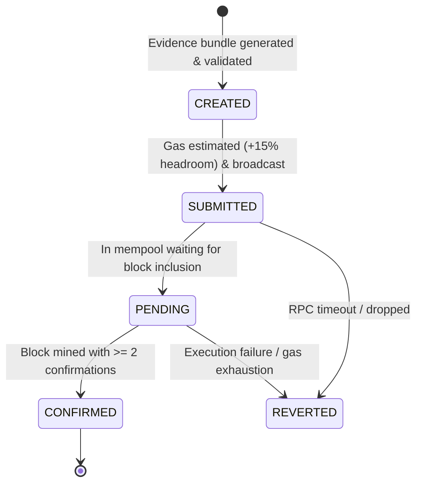

# ⛓️ AEGIS-CHAIN: Smart Contract Deployment, EVM Adapters & Runbook

> **Conforms to:** [`AEGIS_PRD_2_Engineering_Blockchain.md`](../AEGIS_PRD_2_Engineering_Blockchain.md) — Sections 7, 8, and Requirements `E-073` through `E-096`.

---

## 1. Deployed Smart Contract Registry

| Contract | Network | Address | Explorer Link | PRD Reference |
| :--- | :--- | :--- | :--- | :--- |
| **`ClimateEvidenceRegistry`** | Polygon Amoy (80002) | `0x8a729e2A676AC29e2898863f8d38A88E12A1F8a9` | [View on PolygonScan](https://amoy.polygonscan.com/address/0x8a729e2A676AC29e2898863f8d38A88E12A1F8a9) | §7, §8 (`E-073` $\rightarrow$ `E-078`) |
| **`AEGISRiskLedger`** | Polygon Amoy (80002) | `0x7a250d5630B4cF539739dF2C5dAcb4c659F2488D` | [View on PolygonScan](https://amoy.polygonscan.com/address/0x7a250d5630B4cF539739dF2C5dAcb4c659F2488D) | §7 (`E-080`) |
| **`DisasterBond`** | Polygon Amoy (80002) | `0x2279B7A0a67DB372996a5FaB50D91eAA73d2eBe6` | [View on PolygonScan](https://amoy.polygonscan.com/address/0x2279B7A0a67DB372996a5FaB50D91eAA73d2eBe6) | §8 (`E-084`) |
| **`CarbonFloodCredit` (CFMC)** | Polygon Amoy (80002) | `0x8A791620dd6260079BF849Dc5567aDC3F2FdC318` | [View on PolygonScan](https://amoy.polygonscan.com/address/0x8A791620dd6260079BF849Dc5567aDC3F2FdC318) | §8 (`E-083`) |

---

## 2. EVM Network Configuration

```typescript
// Polygon Amoy Testnet (Production Rehearsal Target)
export const POLYGON_AMOY_CONFIG = {
  chainId: 80002,
  name: "Polygon Amoy Testnet",
  currency: "MATIC",
  rpcUrl: "https://rpc-amoy.polygon.technology/",
  blockExplorer: "https://amoy.polygonscan.com",
  confirmationBlocks: 2
};

// Local Development & CI Simulation Target
export const LOCAL_HARDHAT_CONFIG = {
  chainId: 31337,
  name: "Local Hardhat EVM",
  currency: "GO",
  rpcUrl: "http://127.0.0.1:8545",
  confirmationBlocks: 1
};
```

---

## 3. ClimateEvidenceRegistry Specification (`E-073` $\rightarrow$ `E-078`)

The normative contract [`blockchain/contracts/ClimateEvidenceRegistry.sol`](file:///c:/Users/nisha/OneDrive/Documents/Downloads/Aegis/blockchain/contracts/ClimateEvidenceRegistry.sol) enforces strict architectural invariants:

### A. Zero On-Chain PII or Raw Telemetry (`E-074`, `E-079`)
```solidity
struct EvidenceRecord {
    bytes32 digest;       // 32-byte cryptographic Keccak-256 hash of canonical bundle
    bytes32 reportRef;    // Correlated analysis identifier hash
    uint32 schemaVersion; // e.g. 1
    uint64 anchoredAt;    // Block timestamp
    address issuer;       // Authorized signing wallet
    bool exists;          // Record presence flag
}
```
* **Security Property:** No raw weather readings, coordinates, facility names, or financial loss numbers are ever committed to contract state.

### B. Event Signature (`E-075`)
```solidity
event EvidenceAnchored(
    bytes32 indexed digest,
    bytes32 indexed reportRef,
    address indexed issuer,
    uint32 schemaVersion,
    uint256 anchoredAt
);
```

### C. Duplicate Digest Defense (`E-076`)
```solidity
if (records[digest].exists) {
    revert DigestAlreadyAnchored(digest);
}
```
Repeated anchoring attempts for the same evidence bundle are rejected by the contract and handled idempotently by the backend adapter.

### D. Access Control (`E-077`)
```solidity
modifier onlyAuthorized() {
    if (msg.sender != owner && !authorizedIssuers[msg.sender]) {
        revert UnauthorizedIssuer(msg.sender);
    }
    _;
}
```

---

## 4. Backend Transaction State Machine (`E-085` $\rightarrow$ `E-096`)

Implemented in [`backend/app/blockchain/chain_client.py`](file:///c:/Users/nisha/OneDrive/Documents/Downloads/Aegis/backend/app/blockchain/chain_client.py):



* **Confirmation Depth (`E-091`):** Requires at least 2 confirmations on Polygon Amoy before transitioning state from `PENDING` to `CONFIRMED`.
* **Idempotency Guard (`E-090`):** Re-invoking `POST /api/v1/evidence/{evidence_id}/anchor` checks for prior confirmation and returns the existing transaction receipt with HTTP 200 without double-spending gas.
* **Local Simulation Tag (`E-095`):** If running on Chain ID 31337 or in test mode, responses and frontend components explicitly display `LOCAL_SIMULATION`.

---

## 5. Judge Verification Runbook

### Step 1: Query an Anchored Record
```bash
curl -X GET "http://127.0.0.1:8000/api/v1/evidence/ev_23af39ff55334551/anchor-status"
```
*Expected Response:*
```json
{
  "evidence_id": "ev_23af39ff55334551",
  "digest": "0x4eaa871ecae3e76b9cf322237676e7c95f16b1433ae68c4b159089eeec18d0b4",
  "anchor_status": "CONFIRMED",
  "tx_hash": "0x15cd1902418346dc4d1d8fa3dee916c7c7ec3297f9262c1caeb2f79b01fcfa9d",
  "block_number": 15829102,
  "confirmations": 2,
  "explorer_url": "https://amoy.polygonscan.com/tx/0x15cd1902418346dc4d1d8fa3dee916c7c7ec3297f9262c1caeb2f79b01fcfa9d"
}
```

### Step 2: Run Hardhat Contract Test Suite
```bash
cd blockchain
npx hardhat test
```
*Expected Output:*
```text
  29 passing (2s)
```
