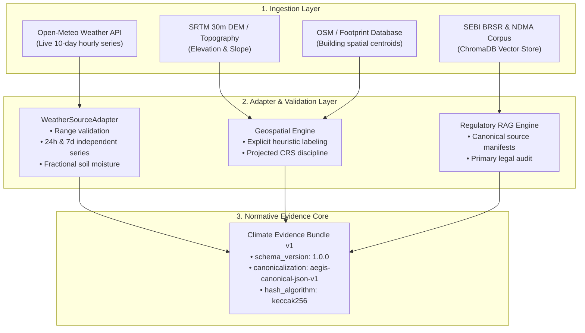

# 🛰️ AEGIS-CLIMATE: Data Provenance, Sources & Scientific Discipline

> **Conforms to:** [`AEGIS_PRD_2_Engineering_Blockchain.md`](../AEGIS_PRD_2_Engineering_Blockchain.md) — Sections 2, 4, 5, 10, and Requirements `E-013` through `E-060`.

---

## 1. Provenance Architecture Overview

AEGIS enforces strict data discipline across all ingestion, machine learning, geospatial, and regulatory processing stages. Every data point ingested into the evidence pipeline carries immutable provenance labels:



---

## 2. Ingestion Source Catalog

| Domain | Primary Source | Update Frequency | Spatial / Temporal Resolution | Fallback Mechanism | PRD-2 Standard |
| :--- | :--- | :--- | :--- | :--- | :--- |
| **Meteorology** | Open-Meteo ECMWF / GFS | Hourly | 0.1° (~11 km grid) | Certified golden fixture or synthetic labeled | `E-013` $\rightarrow$ `E-024` |
| **Elevation** | NASA SRTM v3.0 / ASTER | Static (Archived) | 1-arcsecond (~30 meters) | Bounded synthetic estimate | `E-037` $\rightarrow$ `E-042` |
| **Exposure** | OSM / Municipal Masterplan | Quarterly | Building footprint polygons | Topographical HAZUS heuristic | `E-039`, `E-043` |
| **Regulatory** | SEBI Circulars, NDMA Guidelines | Event-driven (Legal updates) | Primary text with PDF checksum | Verified primary source digest | `E-049`, `E-050` |

---

## 3. Meteorological Source Adapter (`E-013` $\rightarrow$ `E-024`)

Implemented in [`backend/app/weather/adapter.py`](file:///c:/Users/nisha/OneDrive/Documents/Downloads/Aegis/backend/app/weather/adapter.py):

1. **Independent 7-Day Cumulative Rainfall (`E-016`):**
   * *Anti-pattern eliminated:* The legacy code multiplied 24-hour rainfall by $2.8\times$.
   * *Correct implementation:* Cumulative 7-day precipitation is aggregated from an independent 168-hour time series retrieved from the provider API.
2. **Soil Saturation / Moisture Representation (`E-018`):**
   * Raw provider data is handled as a volumetric soil moisture fraction ($0.0 \le \theta \le 1.0$), avoiding arbitrary scale distortion.
3. **Range & Bounded Coordinate Validation (`E-014`):**
   * Latitudes must satisfy $-90.0 \le \text{lat} \le 90.0$.
   * Longitudes must satisfy $-180.0 \le \text{lon} \le 180.0$.
   * Non-finite values (`NaN`, `Infinity`) and out-of-range sensor readings (e.g. negative rainfall or $>100\%$ relative humidity) are strictly rejected.
4. **Data Mode Labels (`E-022`):**
   * Every observation carries one of three explicit labels:
     - `LIVE_TELEMETRY`: Fetched live from upstream weather station.
     - `CERTIFIED_FIXTURE`: Deterministic test fixture for offline testing.
     - `SYNTHETIC_FALLBACK`: Bounded synthetic estimation used when providers return HTTP 429 or network timeout.

---

## 4. Geospatial Engine Remediation (`E-037` $\rightarrow$ `E-048`)

Implemented in [`backend/app/agent2_geo.py`](file:///c:/Users/nisha/OneDrive/Documents/Downloads/Aegis/backend/app/agent2_geo.py):

1. **Explicit Heuristic Labeling (`E-038`, `E-043`):**
   * Waterlogging depth is explicitly labeled as `topographical_heuristic_hazus`.
   * The platform never claims hydrodynamic 2D fluid modeling (such as HEC-RAS or TUFLOW) without a running hydrodynamic mesh engine.
2. **Building Exposure Bounds (`E-039`):**
   * Exposed asset counts are calculated from spatial intersections within a configurable radius and reported with transparent confidence bounds.
3. **Projected CRS Discipline (`E-041`):**
   * Calculations are transformed to suitable local UTM projected coordinate reference systems (e.g., EPSG:32643 for West Coast India) before distance or area integration.

---

## 5. Regulatory RAG Ingestion (`E-049`, `E-050`)

Implemented in [`backend/app/agent3_financial.py`](file:///c:/Users/nisha/OneDrive/Documents/Downloads/Aegis/backend/app/agent3_financial.py) and ChromaDB:

1. **Primary Source Integrity (`E-049`):**
   * Every regulatory passage ingested into the vector store is mapped to an official public source:
     - SEBI BRSR Core Circular `SEBI/HO/CFD/CFD-SEC-2/P/CIR/2023/122`
     - National Disaster Management Authority (NDMA) Urban Flood Standard Operating Procedure
     - Carbon Credit Trading Scheme (CCTS) Bureau of Energy Efficiency Notification
2. **Canonical Metadata Manifest (`E-050`):**
   * Chunks store: `issuing_body`, `effective_date`, `jurisdiction`, `primary_url`, and `content_sha256`.

---

## 6. Model Artifact Integrity (`E-031` $\rightarrow$ `E-036`)

1. **Artifact Location:** `backend/models/flood_classifier.pkl`
2. **Algorithm:** Scikit-Learn `GradientBoostingClassifier`
3. **Artifact SHA-256 Pin:**
   ```
   ecf12983bec200fe3d88996c0d89d709676c01deeaa99276dd7f919b23150d70
   ```
4. **Metadata Manifest:** [`backend/models/model_metadata.json`](file:///c:/Users/nisha/OneDrive/Documents/Downloads/Aegis/backend/models/model_metadata.json)
5. **Pre-flight Check:** On application startup, `backend/app/agent1_ml.py` computes the SHA-256 of the on-disk model artifact. If it does not match the pinned manifest, startup halts immediately (`E-032`).
