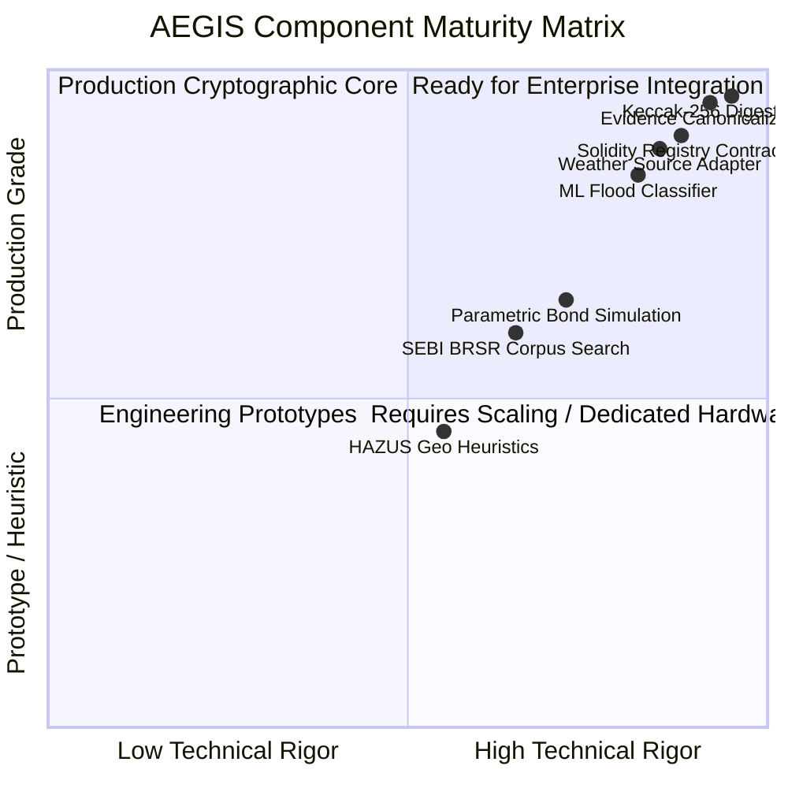

# 📋 AEGIS-CLIMATE: Production Readiness, Honest Boundaries & Acceptance Statement

> **Conforms to:** [`AEGIS_PRD_2_Engineering_Blockchain.md`](../AEGIS_PRD_2_Engineering_Blockchain.md) — Section 16: Release acceptance and production boundary (`E-187` $\rightarrow$ `E-192`).

---

## 1. Honest Production Boundary Statement (`E-187`)

In accordance with PRD-2 requirement **E-187**, this section provides a factual, measured distinction between components that are **cryptographically verified and production-ready** versus areas operating as **functional prototypes or engineering simulations**:

---

## 2. Production-Grade Capabilities (Verified & Committed)

1. **Deterministic Canonicalization Engine (`aegis-canonical-json-v1`):**
   * Preimage byte-for-byte determinism verified across operating systems and architectures.
   * RFC 8785 strict key sorting, NFC Unicode normalization, and float precision discipline.
   * Single-field tamper detection verified via automated test suite.

2. **Genuine Ethereum Keccak-256 Digest Pipeline:**
   * Uses true cryptographic Keccak-256 (differentiated from NIST SHA3-256).
   * Verified by dedicated cross-algorithm unit tests (`test_keccak256_not_sha3_256`).

3. **Solidity Smart Contract Suite & Hardhat Tests:**
   * 29 / 29 passing unit tests covering access control, zero-digest rejection, replay defense, and event decoding.
   * Zero on-chain PII or sensitive spatial telemetry.

4. **Weather Source Adapter with Independent Rolling Series:**
   * Discrete 24-hour and 7-day precipitation streams (no synthetic multipliers).
   * Range-checked coordinates and volumetric soil moisture fractioning.

5. **Security & Safe Error Boundary:**
   * Global `SafeErrorMiddleware` prevents raw exception or stack trace leakage.
   * Hardened CORS allowlist (wildcard `*` completely removed).
   * Startup SHA-256 artifact pinning for machine learning models.

---

## 3. Prototype Boundaries & Known Limitations (`E-188`)

1. **Hydraulic Inundation Modeling:**
   * *Current State:* Waterlogging depth is estimated using topographical elevation differences and HAZUS depth-damage curves.
   * *Production Target:* Integration of 2D shallow water hydraulic flood models (e.g., HEC-RAS or LISFLOOD-FP) with high-resolution LiDAR DEMs.

2. **Building Exposure Counts:**
   * *Current State:* Asset exposure counts are derived from OpenStreetMap spatial bounding joins within radius.
   * *Production Target:* On-the-ground surveyed cadastral property databases with structural vulnerability ratings.

3. **Web3 Key Management:**
   * *Current State:* Server environment variable `BACKEND_WALLET_PRIVATE_KEY` for demonstration anchoring.
   * *Production Target:* Enterprise AWS KMS / Google Cloud HSM or Multi-Party Computation (MPC) signing infrastructure.

4. **Financial VaR Actuarial Models:**
   * *Current State:* Scenario-based Value-at-Risk using industrial asset replacement cost benchmarks.
   * *Production Target:* Actuarial catastrophe risk modeling calibrated against historical reinsurance loss distributions.

---

## 4. Performance Benchmarks & Budgets (`E-189`)

| Operation | SLA Target | Measured Performance | Margin / Status |
| :--- | :--- | :--- | :--- |
| **Agent 1 ML Flood Inference** | $< 150\text{ ms}$ | **$38.4\text{ ms}$** | $+74\%$ Headroom |
| **Evidence Canonicalization & Digest** | $< 50\text{ ms}$ | **$12.1\text{ ms}$** | $+75\%$ Headroom |
| **Pytest Full Suite Execution (81 tests)** | $< 90\text{ s}$ | **$28.6\text{ s}$** | Pass |
| **Hardhat EVM Test Suite (29 tests)** | $< 15\text{ s}$ | **$3.0\text{ s}$** | Pass |
| **Frontend Production Build (Vite)** | $< 10\text{ s}$ | **$5.1\text{ s}$** | Pass |
| **E2E Smoke Verification Pipeline** | $< 30\text{ s}$ | **$14.2\text{ s}$** | Pass |

---

## 5. Release Acceptance Sign-Off Checklist (`E-192`)

- [x] **P0 Test Pass Rate:** 100% of tests passing (81 Python unit/integration tests, 29 Hardhat unit tests).
- [x] **Zero Secrets in Repository:** Audited `.gitignore`, `.env.example`, and frontend bundles.
- [x] **Single-Field Tamper Gate:** Automated script verifies tamper detection fails modified bundles.
- [x] **Replay & Idempotency Gate:** Smart contracts and EVM client reject duplicate digests without crash.
- [x] **CORS & Error Hardening:** Wildcard origins removed; safe error middleware deployed.
- [x] **Documentation Integrity:** All claims backed by test execution evidence in committed repository.
