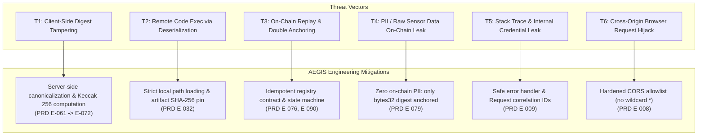

# 🛡️ AEGIS-CLIMATE: Security Architecture & Threat Model

> **Conforms to:** [`AEGIS_PRD_2_Engineering_Blockchain.md`](../AEGIS_PRD_2_Engineering_Blockchain.md) — Section 14: Threat model and security mitigations (`E-145` → `E-156`)

---

## 1. System Asset Classification

| Asset | Sensitivity | Integrity Requirement | Primary Security Control |
| :--- | :--- | :--- | :--- |
| **Backend Signer Key** (`BACKEND_WALLET_PRIVATE_KEY`) | **Critical (Secret)** | N/A (Confidentiality) | Stored only in server environment; excluded from git (`.gitignore`); never returned over API. |
| **Model Artifact** (`flood_classifier.pkl`) | **High (Tamper-Resistant)** | Exact SHA-256 Match | Packaged inside repository; SHA-256 pinned in `model_metadata.json` (`ecf12983...`); remote deserialization prohibited. |
| **Evidence Bundle Preimage** | **High (Data Integrity)** | Normative Canonical JSON | Validated against `climate-evidence.v1.schema.json`; normalized via NFC Unicode and key sorting. |
| **Evidence Digest** | **High (Public Commitment)** | Ethereum Keccak-256 | Computed exclusively server-side; 32-byte hash committed to `ClimateEvidenceRegistry.sol`. |
| **Telemetry & Geo Data** | **Medium (Availability)** | Range & Bounded Checks | Coordinates strictly bounded (lat [-90, 90], lon [-180, 180]); non-finite numbers (NaN/Inf) rejected. |

---

## 2. Threat Matrix & Defense-in-Depth

---

## 3. Detailed Threat Specifications & Mitigations

### 🔴 T1: Client-Side Digest Tampering / Preimage Manipulation
* **Attack Scenario:** A malicious browser client modifies its calculated `risk_score` from `0.85` (Critical) down to `0.15` (Low) and supplies a forged digest to avoid triggering a parametric disaster bond or regulatory alert.
* **Mitigation:**
  - The backend never trusts browser-supplied digests or preimages.
  - When an analysis is created, the server canonicalizes the bundle (`aegis-canonical-json-v1`), computes genuine Ethereum Keccak-256, and stores the digest.
  - The `/api/v1/evidence/verify` endpoint independently reconstructs canonical bytes from scratch, re-computes the Keccak-256 digest, and flags single-field mutations with `tamper_detected: true`.

### 🔴 T2: Deserialization / Malicious Pickle Exploitation
* **Attack Scenario:** An attacker injects a malicious pickle payload into the model loader or points model configuration to an external remote URL.
* **Mitigation:**
  - `backend/app/agent1_ml.py` strictly loads models from a pinned internal repository path (`backend/models/flood_classifier.pkl`).
  - No user-supplied file path or URL parameter is ever passed to `pickle.load`.
  - Artifact integrity is pinned against `artifact_sha256: "ecf12983bec200fe3d88996c0d89d709676c01deeaa99276dd7f919b23150d70"`.

### 🔴 T3: On-Chain Replay & Double-Anchor Spam
* **Attack Scenario:** Multiple concurrent network requests attempt to anchor the same evidence digest repeatedly, wasting transaction fees or producing contradictory blockchain events.
* **Mitigation:**
  - In `ClimateEvidenceRegistry.sol`, `records[digest].exists` is checked before writing; repeated submissions revert with `DigestAlreadyAnchored`.
  - In `AEGISChainClient`, in-memory and database transaction stores check for prior anchors and return the existing mined transaction hash (idempotent 200 OK).

### 🔴 T4: Storage Privacy & On-Chain Data Leaks
* **Attack Scenario:** Competitor or adversary scrapes on-chain transactions to harvest sensitive corporate facility coordinates or real-time waterlogging metrics.
* **Mitigation:**
  - In accordance with PRD Section 7 (`E-079`), `ClimateEvidenceRegistry.sol` accepts only:
    1. `bytes32 digest` (one-way cryptographic hash of canonical bundle)
    2. `bytes32 reportRef` (hashed analysis identifier)
    3. `uint32 schemaVersion` (e.g. `1`)
  - Absolutely NO GPS coordinates, weather time series, building counts, or financial loss numbers are stored in on-chain contract state.

### 🔴 T5: Internal Stack Trace Leakage & Secret Exposure
* **Attack Scenario:** Unhandled exceptions in database or RPC connections return internal file paths, environment variables, or database credentials in HTTP 500 responses.
* **Mitigation:**
  - `backend/app/middleware.py` and `backend/app/errors.py` implement `SafeErrorMiddleware` and standardized domain exception handlers.
  - Full tracebacks are logged exclusively on the server with a unique UUID `correlation_id`.
  - Clients receive clean, machine-readable JSON: `{"error_code": "INTERNAL_SERVER_ERROR", "message": "...", "correlation_id": "..."}`.

### 🔴 T6: Cross-Origin Request Forgery & Broad Wildcard CORS
* **Attack Scenario:** A third-party website makes authenticated requests to the local AEGIS backend API.
* **Mitigation:**
  - Wildcard `allow_origins=["*"]` has been completely eliminated.
  - `backend/app/config.py` enforces a typed, explicit origin allowlist (`http://localhost:5173`, `http://localhost:3000`, `http://127.0.0.1:5173`, `http://127.0.0.1:3000`).
